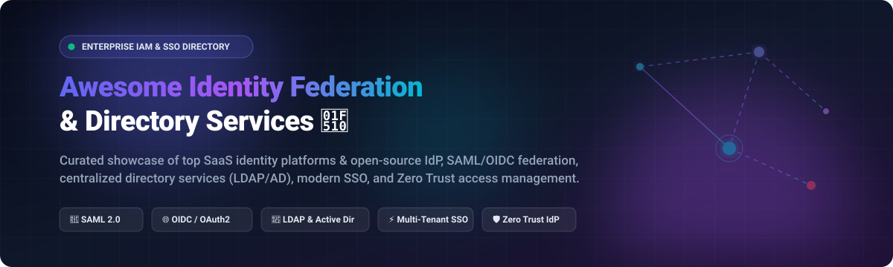
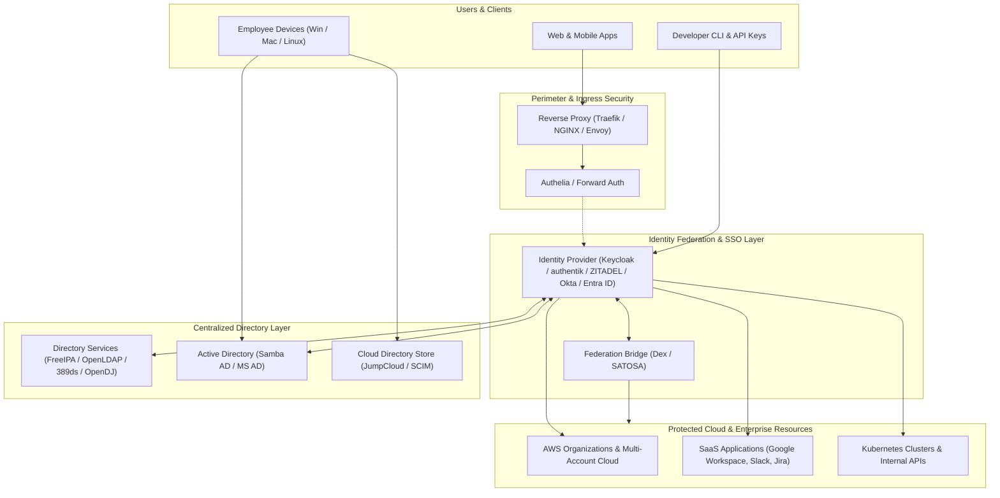

  

# 🔐 Awesome Identity Federation & Directory Services

  
  
  
  
  
  

---

> **A curated showcase of top SaaS identity platforms and open-source identity providers (IdPs), SAML 2.0 / OpenID Connect (OIDC) federation, centralized directory services (LDAP / Active Directory), Single Sign-On (SSO), and Zero Trust access management.**

*Whether architecting enterprise identity lifecycles, migrating from legacy on-premises Active Directory to modern cloud directory fabrics, or deploying cloud-native OAuth2 microservices, this repository aggregates industry-leading enterprise SaaS and battle-tested open-source solutions.*

---

## 📑 Table of Contents

- [📊 Sector Overview & Market Dynamics](#-sector-overview--market-dynamics)
- [☁️ SaaS / Hosted Identity Platforms](#️-saas--hosted-identity-platforms)
- [🚀 Open-Source GitHub Projects](#-open-source-github-projects)
  - [Full-Featured Identity Providers (IdP & SSO)](#full-featured-identity-providers-idp--sso)
  - [Cloud-Native Auth & Microservices Infrastructure](#cloud-native-auth--microservices-infrastructure)
  - [Directory Services, LDAP & Active Directory](#directory-services-ldap--active-directory)
  - [Federation Proxies & Identity Bridges](#federation-proxies--identity-bridges)
- [🛠️ Recommended Architecture Blueprints](#️-recommended-architecture-blueprints)
- [🤝 How to Contribute](#-how-to-contribute)
- [💖 Support](#-support)
- [⭐ Star History](#-star-history)
- [⚖️ Disclaimer](#️-disclaimer)

---

## 📊 Sector Overview & Market Dynamics

The global **Identity and Access Management (IAM)** and **Identity Federation** market is valued at approximately **$25B–$30B in 2025–2026** and projected to exceed **$60B–$75B by the early 2030s**, growing at a steady compound annual growth rate (CAGR) of **~11–15%**.

The sector exhibits **moderate fragmentation with accelerating concentration** around hyperscale cloud ecosystems (Microsoft Entra ID, AWS IAM Identity Center) and independent identity platform leaders (Okta/Auth0). Simultaneously, private equity roll-ups (such as the combination of Ping Identity and ForgeRock under Thoma Bravo) and active community adoption of open-source frameworks (Keycloak, Authelia, authentik, ZITADEL) preserve vibrant multi-vendor competition across cloud, on-premises, and hybrid enterprise infrastructure.

---

## ☁️ SaaS / Hosted Identity Platforms

| Company / Platform | Company Scale (Valuation / Revenue) | Starting Paid Pricing | Free Tier / Trial Limits | Description |
| :--- | :--- | :--- | :--- | :--- |
| **[Microsoft Entra ID](https://www.microsoft.com/en-us/security/business/identity-access/microsoft-entra-id)** | ~$3.1T Market Cap / ~$245B+ Rev (Parent: Microsoft) | $6.00 / user / month (Entra ID P1); $9.00 / user / month (Entra ID P2) | **Free Forever**: Up to 50,000 directory objects, SSO across unlimited cloud apps, and core MFA. Paid editions offer a 30-day free trial (up to 100 licenses). | Cloud-based IAM and directory service (formerly Azure AD) providing SSO, MFA, conditional access, and directory federation for Microsoft and third-party apps. |
| **[AWS IAM Identity Center](https://aws.amazon.com/iam/identity-center/)** | ~$2.2T Market Cap / ~$105B+ AWS Rev (Parent: Amazon) | Included at no additional cost ($0.00) | **Free Forever**: 100% free with no user or application caps for AWS accounts, built-in identity store, and SAML 2.0 federation (underlying services like AWS Managed Microsoft AD incur separate standard AWS fees). | Centralized workforce identity management service for multi-account AWS environments and business cloud applications through single sign-on. |
| **[Okta](https://www.okta.com/)** | ~$13B Market Cap / ~$2.6B+ ARR | $2.00 / user / month (Single Sign-On); $3.00 / user / month (Universal Directory) | **Free Trial Only**: 30-day free trial with full access to Workforce Identity Cloud features; developer tier offers free tenant up to 7,500 monthly active users (MAU). | Leading enterprise identity platform offering workforce and customer identity, SSO, lifecycle management, and thousands of pre-built integrations. |
| **[Zoho Directory](https://www.zoho.com/directory/)** | ~$12.5B Estimated Valuation / ~$1.5B Rev | $2.00 / user / month ($1.70/mo billed annually - Standard Plan) | **Free Forever**: Up to 10 users, unlimited Zoho apps, up to 3 third-party cloud apps with SSO, Cloud RADIUS/LDAP for 10 users, and 7-day audit logs. 15-day free trial for paid plans. | Workforce identity, application access, and centralized directory service tailored for SMBs and enterprise Zoho ecosystems. |
| **[CyberArk Identity](https://www.cyberark.com/)** | ~$12B Market Cap / ~$1.0B+ ARR | ~$6.00 – $7.00 / user / month (Workforce Identity Standard; annual contract with minimum user commitments) | **Free Trial Only**: 14-day to 30-day evaluation sandbox / guided Proof of Concept (PoC) tenant upon sales request. | Identity security and access management platform integrating workforce SSO, adaptive MFA, and privileged access security controls. |
| **[OneLogin](https://www.onelogin.com/)** | ~$5.4B Valuation (Parent: Quest Software / One Identity; ~$500M+ Quest Rev) | $3.00 / user / month (Basic Plan); $6.00 / user / month (Advanced Plan) | **Free Trial Only**: 30-day free trial with full access to cloud directory, SSO, MFA, and user provisioning workflows; no credit card required. | Cloud IAM solution delivering single sign-on, MFA, directory integration, and automated user provisioning (part of One Identity / Quest). |
| **[PingFederate / Ping Identity](https://www.pingidentity.com/)** | ~$5.1B Combined Valuation ($2.8B buyout + $2.3B ForgeRock; Parent: Thoma Bravo) | $3.00 / user / month (PingOne Workforce Essential; enterprise volume minimums apply) | **Free Trial Only**: 30-day free trial with up to 1,000 active user identities and 5 sandbox environments. | Enterprise federation and access management platform specializing in SAML, OAuth, OIDC, and complex hybrid identity architectures. |
| **[JumpCloud](https://jumpcloud.com/)** | ~$2.6B Private Valuation / ~$200M ARR | $3.00 / user / month (Core Identity Plan); $9.00 / user / month (Platform Plan) | **Free Forever**: Up to 10 users and 10 devices with all platform features, plus 30 days of premium 24/7 support. | Cloud directory platform delivering identity, access, and cross-OS device management (Windows, Mac, Linux) as an alternative to on-premises AD. |
| **[ForgeRock](https://www.forgerock.com/)** | ~$2.3B Acquisition Valuation (Combined into Ping Identity / Thoma Bravo) | ~$3.00 – $5.00 / user / month (Enterprise-grade pricing via unified Ping Identity platform; enterprise quote minimums apply) | **Free Trial Only**: 30-day evaluation access / sandbox tenant via unified Ping Identity evaluation platform. | Comprehensive identity platform covering access management, identity governance, directory services, and edge identity gateway capabilities. |
| **[Auth0](https://auth0.com/)** | Acquired for $6.5B (Operating unit of Okta, Inc. - ~$13B Market Cap) | $35.00 / month (B2C Essentials Plan, includes 1,000 MAU; B2B plans start at $130.00 / month) | **Free Forever**: Up to 7,500 monthly active users (MAU), unlimited logins, up to 3 social identity providers, and basic MFA. | Developer-first identity platform specializing in Customer Identity and Access Management (CIAM), flexible token customization, and extensibility. |

---

## 🚀 Open-Source GitHub Projects

All open-source repositories are strictly ranked below in **descending order by GitHub Stars_Count**. Each repository badge links directly to its live stargazers page.

### 🌟 Ranked Open-Source Repositories

1. **[Keycloak](https://github.com/keycloak/keycloak)**   
   Industry standard open-source Identity and Access Management system sponsored by Red Hat. Supports OpenID Connect (OIDC), OAuth 2.0, SAML 2.0, user federation across LDAP/AD, identity brokering, social authentication, and fine-grained authorization.

2. **[Authelia](https://github.com/authelia/authelia)**   
   Lightweight authentication and authorization server providing single sign-on (SSO) and multi-factor authentication (MFA: TOTP, FIDO2 WebAuthn, Duo) for applications reverse-proxied by NGINX, Traefik, Caddy, or HAProxy.

3. **[authentik](https://github.com/goauthentik/authentik)**   
   Modern, extensible open-source Identity Provider focused on flexibility and ease of use. Features built-in reverse proxy authentication (Forward Auth), SAML, OIDC, SCIM directory provisioning, custom flow stages, and a responsive web UI.

4. **[Ory Hydra](https://github.com/ory/hydra)**   
   High-performance, hardened OpenID Certified™ OAuth 2.0 Server and OpenID Connect Provider written in Go. Headless and designed to integrate cleanly with any existing user directory or authentication service.

5. **[ZITADEL](https://github.com/zitadel/zitadel)**   
   Cloud-native, event-sourced IAM platform designed for multi-tenancy from day one. Features turnkey B2B organization switching, passkeys/FIDO2, OIDC/OAuth2 federation, and self-service administration.

6. **[SuperTokens](https://github.com/supertokens/supertokens-core)**   
   Modular open-source alternative to Auth0 and AWS Cognito. Provides robust session management, social login, passwordless auth, multi-factor authentication, and user migration utilities.

7. **[Logto](https://github.com/logto-io/logto)**   
   Modern, developer-centric alternative to Auth0 for building identity workflows. Offers ready-to-use sign-in experience, multi-tenant B2B organization support, enterprise SSO (SAML/OIDC), and role-based access control.

8. **[Casdoor](https://github.com/casdoor/casdoor)**   
   UI-first, web-native Identity and Access Management platform supporting OAuth 2.0, OIDC, SAML, CAS, LDAP synchronization, WebAuthn, SMS/email verification, and social login across dozens of providers.

9. **[Ory Kratos](https://github.com/ory/kratos)**   
   API-first, headless identity and user management system implementing self-service registration, login, multi-factor authentication (MFA/TOTP/WebAuthn), password recovery, and profile verification.

10. **[Apereo CAS](https://github.com/apereo/cas)**   
    Enterprise multilingual Single Sign-On engine for web applications supporting CAS protocol, SAML 1.1/2.0, OpenID Connect, OAuth 2.0, RADIUS, and delegated authentication against LDAP and relational databases.

11. **[Dex](https://github.com/dexidp/dex)**   
    Federation identity provider that acts as an OpenID Connect (OIDC) bridge to plug into Kubernetes and web services. Delegates authentication to LDAP servers, SAML IdPs, GitHub, Google, and GitLab.

12. **[Kanidm](https://github.com/kanidm/kanidm)**   
    Modern, memory-safe enterprise identity management platform written in Rust. Features an integrated directory service, native RADIUS support, OAuth2/OIDC provider capabilities, and modern WebAuthn credential flows.

13. **[FreeIPA](https://github.com/freeipa/freeipa)**   
    Red Hat-sponsored integrated enterprise identity management suite combining 389 Directory Server (LDAP), MIT Kerberos, Dogtag PKI certificate authority, NTP, DNS, and central HBAC policy controls for Linux/Unix networks.

14. **[Samba Active Directory](https://github.com/samba-team/samba)**   
    Complete open-source implementation of Microsoft Active Directory Domain Services (AD DS). Allows running full AD domain controllers on Linux with Kerberos, LDAP, and GPO support for Windows and cross-platform clients.

15. **[SimpleSAMLphp](https://github.com/simplesamlphp/simplesamlphp)**   
    Battle-tested PHP application implementing SAML 2.0 Identity Provider (IdP) and Service Provider (SP) capabilities, widely deployed in academic and research federations (e.g., eduGAIN, InCommon).

16. **[OpenAM](https://github.com/OpenIdentityPlatform/OpenAM)**   
    Community-maintained open-source access management platform (derived from ForgeRock OpenAM / Sun OpenSSO) providing enterprise web SSO, SAML 2.0, OAuth 2.0, adaptive authentication, and fine-grained authorization.

17. **[OpenDJ](https://github.com/OpenIdentityPlatform/OpenDJ)**   
    High-throughput LDAPv3 compliant directory service written in Java (continuation of ForgeRock OpenDJ / Sun OpenDS), featuring multi-master replication, access control, and REST-to-LDAP gateways.

18. **[Gluu oxAuth](https://github.com/GluuFederation/oxAuth)**   
    OpenID Certified OAuth 2.0 Authorization Server and OpenID Connect Provider implementing Client-Initiated Backchannel Authentication (CIBA), FAPI security profiles, and enterprise federation.

19. **[389 Directory Server](https://github.com/389ds/389-ds-base)**   
    Enterprise-grade, multi-master LDAP directory server for Linux (the core directory engine behind FreeIPA and Red Hat Directory Server), optimized for high write performance and complex replication topologies.

20. **[SATOSA](https://github.com/IdentityPython/SATOSA)**   
    Stateful multi-protocol federation proxy written in Python capable of translating seamlessly between SAML 2.0 and OpenID Connect (OIDC) identity providers and service providers.

---

## 🛠️ Recommended Architecture Blueprints

* **Modern Cloud-Native Stack**: Combine **authentik** or **ZITADEL** with **Dex** for Kubernetes OIDC authentication and reverse-proxy SSO.
* **Hybrid Enterprise Stack**: Deploy **FreeIPA** or **Samba AD** as the core directory authority, federated through **Keycloak** via SAML 2.0 / OIDC into enterprise SaaS.
* **Zero Trust Edge Architecture**: Place **Authelia** behind NGINX or Traefik for 2FA-enforced ingress to private web services with hardware security keys (FIDO2 / WebAuthn).

---

## 🤝 How to Contribute

1. 🍴 Fork this repository.
2. 🌿 Create a descriptive feature branch (`git checkout -b add-identity-tool`).
3. 📝 Add or update entries with factual descriptions, active links, and appropriate categories.
4. 🚀 Submit a Pull Request with a summary of the additions.

---

## 💖 Support

If you find this curated directory useful for your security architecture, enterprise IAM evaluations, or DevOps projects, please consider supporting the project:

- ⭐ **Star this repository** to help others discover it!
- 🍴 **Fork and share** with your network, team, or security communities.
- ☕ **Sponsor or buy a coffee**: Support ongoing curation and maintenance directly via the [GitHub Sponsors Dashboard](https://github.com/sponsors/ishandutta2007).

Your support is deeply appreciated!

---

## ⭐ Star History

---

## ⚖️ Disclaimer

- This is a **community-curated directory** provided for educational, architectural, and informational purposes. It does not constitute formal cybersecurity consulting or identity architecture endorsement.
- Identity and access management (IAM) represents a mission-critical security control plane. Misconfiguration of identity providers, federation tokens, or directory access lists can lead to privilege escalation or service outages. Thoroughly test all solutions in staging environments prior to production rollout.

---

  <b>Built for Identity Architects, IAM Engineers, Security Practitioners, and Open-Source Advocates.</b> 
  <i>Keeping identity federation standards-based, interoperable, and under your control.</i>

